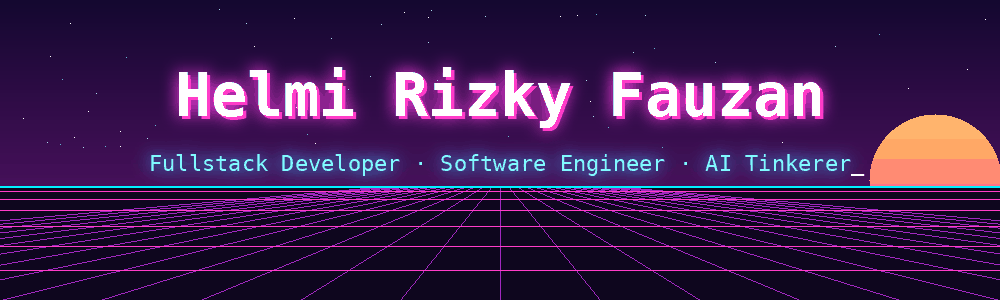

 

## 💫 About Me

- 🤖 Working on **AI** and **software applications**
- 🌙 Experimenting on **Moonlight**
- ☀️ Building **Daylight**
- 🚀 Currently employed at a startup

## 💻 Tech Stack

**Cloud & Infrastructure** 
    

**Languages** 
      

**Backend** 
    

**Frontend & Creative** 
       

**Databases** 
  

**AI & Data** 
      

**Tooling** 
  

## 📊 GitHub Stats

<!-- Proudly created with GPRM ( https://gprm.itsvg.in ) -->